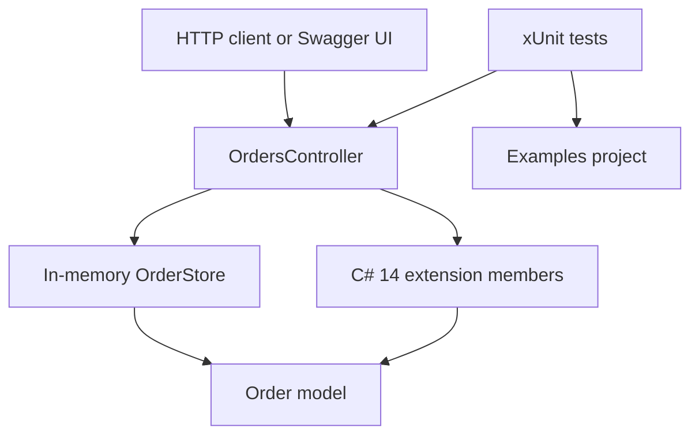

# C# 14 Extension Members — A Better Way to Extend Your Types?

Traditional extension methods add a method to a type you do not own. The method is static, its first parameter uses `this`, and the call looks like an instance method.

C# 14 keeps that feature and adds extension blocks. A block can group methods, and it can also declare properties and static members. Properties are computed. They do not add stored fields. Static members are called on the type, such as `Order.HighValueThreshold`.

The examples below are small and compilable. The API is a separate order-management demo that uses the same ideas on a real request path.

## Contents

- [What you will learn](#what-you-will-learn)
- [Quick comparison](#quick-comparison)
- [Examples](#examples)
- [Before vs after](#before-vs-after)
- [Real-world scenario](#real-world-scenario)
- [API demonstration](#api-demonstration)
- [Architecture](#architecture)
- [Run locally](#run-locally)
- [Requirements](#requirements)
- [Key lesson](#key-lesson)

## What you will learn

- Traditional extension methods
- Extension blocks
- Extension properties
- Static extension members
- Generic extension members
- API design and compatibility

## Quick comparison

Traditional extension method:

```csharp
public static bool IsHighValue(this Order order)
    => order.TotalAmount >= 1000m;
```

C# 14 extension property. The block sits in a top-level, non-generic static class:

```csharp
extension(Order order)
{
    public bool IsHighValue
        => order.TotalAmount >= 1000m;
}
```

Usage:

```csharp
var order = new Order { TotalAmount = 1250m };

if (order.IsHighValue())
{
    // Traditional method. The parentheses stay.
}

if (order.IsHighValue)
{
    // C# 14 property. The value is computed. Nothing is stored.
}
```

Do not declare both with the same name in one scope. The compiler reports `CS9339` because the method and the property are ambiguous. Pick one.

## Examples

Open any file below. Each one shows the older form, the C# 14 form, a usage call, and the limits that matter.

| Example | Concept | Source |
| --- | --- | --- |
| Traditional | Classic extension methods | [01-TraditionalExtensionMethods.cs](Examples/01-TraditionalExtensionMethods.cs) |
| Extension blocks | New C# 14 syntax | [02-ExtensionBlocks.cs](Examples/02-ExtensionBlocks.cs) |
| Extension properties | Property-style access | [03-ExtensionProperties.cs](Examples/03-ExtensionProperties.cs) |
| Static extensions | Type-level extension APIs | [04-StaticExtensionMembers.cs](Examples/04-StaticExtensionMembers.cs) |
| Generic extensions | Generic extension blocks | [05-GenericExtensionMembers.cs](Examples/05-GenericExtensionMembers.cs) |
| Before vs After | Complete comparison | [06-BeforeVsAfter.cs](Examples/06-BeforeVsAfter.cs) |

- **Traditional** shows a helper that takes the order as an argument, then the same rule as `order.IsHighValue()`.
- **Extension blocks** groups related methods. The call site does not change.
- **Extension properties** drops the parentheses and shows a setter that writes through to the note the object already stores.
- **Static extensions** moves a threshold and a draft factory from a helper class onto `Order`.
- **Generic extensions** adds `IsEmpty` and `HasItems` to any `IReadOnlyCollection<T>`.
- **Before vs After** runs the helper and the extension members on one order and compares the results.

The practical version used by HTTP requests is [OrderExtensions.cs](src/ExtensionMembers.Api/OrderExtensions.cs) and [CollectionExtensions.cs](src/ExtensionMembers.Api/CollectionExtensions.cs).

## Before vs after

| | Before | C# 14 |
| --- | --- | --- |
| Syntax | A static method with a `this` parameter | An `extension` block in a static class |
| Extension properties | Not available. Use a method. | `order.IsHighValue` reads like data and is computed |
| Static extension members | A separate class, such as `OrderRules.HighValueThreshold` | `Order.HighValueThreshold` when the extension is in scope |
| Generic extension blocks | A generic method with `this` | `extension<T>(IReadOnlyCollection<T> items)` |
| Compatibility | Works on older C# compilers | Moving a method into a block keeps the call. Property syntax needs C# 14 |
| Limitations | Methods only | No stored state. No override. Instance members win. Properties cannot appear in expression trees |

Details, including `CS9296` and `CS9339`, are in [docs/compatibility.md](docs/compatibility.md).

## Real-world scenario

An order record stores an id, a customer, an amount, a status, and a time. "High value", "priority", and "can cancel" are rules, not columns. If those rules live in a helper class, a reader has to know the helper's name before the rules show up.

Extension members put the rules on `order` and `Order`. In this API, `order.IsHighValue`, `order.Priority`, and `order.CanCancel` are visible beside the stored data, and `Order.HighValueThreshold` is the one number those rules share. `orders.IsEmpty` is a generic check, so the insights endpoint does not need an order-specific helper.

The controller stays small: load an order, then call `order.ToSummary()`. The summary mixes stored values with the computed rules. Nothing is added to the object, and a later real `IsHighValue` property on `Order` would win over the extension.

## API demonstration

The API keeps three orders in memory. They reset when the process stops. Swagger UI is at [http://localhost:5080/swagger](http://localhost:5080/swagger) after you run the project. The OpenAPI document is [http://localhost:5080/swagger/v1/swagger.json](http://localhost:5080/swagger/v1/swagger.json). Opening `/` redirects to Swagger.

| Method | Path | What it returns |
| --- | --- | --- |
| `GET` | `/api/orders` | Every order, including computed fields |
| `GET` | `/api/orders/{id}` | One order, or 404 |
| `GET` | `/api/orders/high-value` | Orders at or above `Order.HighValueThreshold` |
| `GET` | `/api/orders/insights` | The threshold, the counts, and whether the list is empty |
| `POST` | `/api/orders` | Places an order in `Submitted` status |

`GET /api/orders/1`

```json
{
  "id": 1,
  "customerName": "Northwind Traders",
  "totalAmount": 1250.00,
  "status": "Submitted",
  "isHighValue": true,
  "priority": "High",
  "canCancel": true,
  "createdAt": "2026-03-01T09:00:00+00:00"
}
```

The seeded list also includes Contoso (`75.50`, Draft, standard priority, can cancel) and Fabrikam (`2400.00`, Shipped, high priority, cannot cancel). `GET /api/orders/high-value` returns Northwind and Fabrikam.

`GET /api/orders/insights`

```json
{
  "highValueThreshold": 1000,
  "totalOrders": 3,
  "highValueOrders": 2,
  "isEmpty": false
}
```

`POST /api/orders`

```json
{
  "customerName": "Ada Lovelace",
  "totalAmount": 1500
}
```

`201 Created`, with `Location: /api/orders/4` on a fresh process:

```json
{
  "id": 4,
  "customerName": "Ada Lovelace",
  "totalAmount": 1500,
  "status": "Submitted",
  "isHighValue": true,
  "priority": "High",
  "canCancel": true,
  "createdAt": "2026-11-09T11:42:16.6947346+00:00"
}
```

`createdAt` is the UTC time of the request, so that value changes. A missing customer name returns `400` with `"Customer name is required."` A negative total returns `400` with `"Total amount cannot be negative."` An unknown id returns `404` with the title `"Order not found"`. The host also adds a `traceId` to those problem responses.

The same requests are in [ExtensionMembers.Api.http](src/ExtensionMembers.Api/ExtensionMembers.Api.http).

## Architecture



```text
CSharp14-ExtensionMembers/
├── README.md
├── CSharp14-ExtensionMembers.sln
├── Examples/
│   ├── 01-TraditionalExtensionMethods.cs
│   ├── 02-ExtensionBlocks.cs
│   ├── 03-ExtensionProperties.cs
│   ├── 04-StaticExtensionMembers.cs
│   ├── 05-GenericExtensionMembers.cs
│   └── 06-BeforeVsAfter.cs
├── src/ExtensionMembers.Api/
├── tests/ExtensionMembers.Tests/
└── docs/compatibility.md
```

## Run locally

From the repository root:

```text
dotnet restore

dotnet build

dotnet test

dotnet run --project src/ExtensionMembers.Api
```

`dotnet build` and `dotnet test` use `CSharp14-ExtensionMembers.sln`. The run command starts the API from [src/ExtensionMembers.Api](src/ExtensionMembers.Api/ExtensionMembers.Api.csproj) at `http://localhost:5080`, which is set in [launchSettings.json](src/ExtensionMembers.Api/Properties/launchSettings.json).

## Requirements

- .NET 10 SDK. C# 14 is the language version for `net10.0`. Each project also sets `<LangVersion>14</LangVersion>`.
- A C# 14 compiler is required to build the `extension` blocks and to call extension properties. Traditional extension methods remain valid on older compilers.
- No database, no account, and no secret configuration.

References:

- [What's new in C# 14](https://learn.microsoft.com/en-us/dotnet/csharp/whats-new/csharp-14)
- [The extension keyword](https://learn.microsoft.com/en-us/dotnet/csharp/language-reference/keywords/extension)
- [Compatibility notes for this repo](docs/compatibility.md)

## Key lesson

> C# 14 Doesn't Replace Extension Methods. It Expands What Extensions Can Express.
